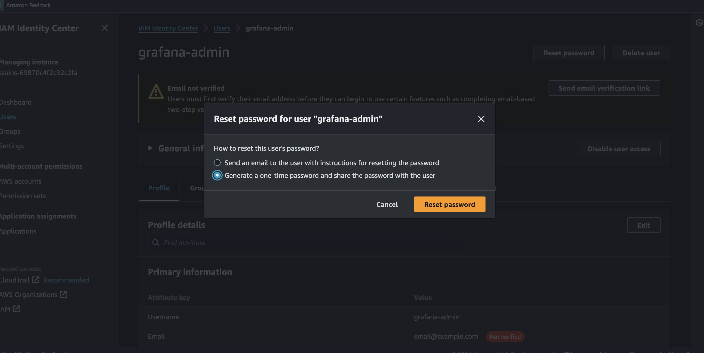
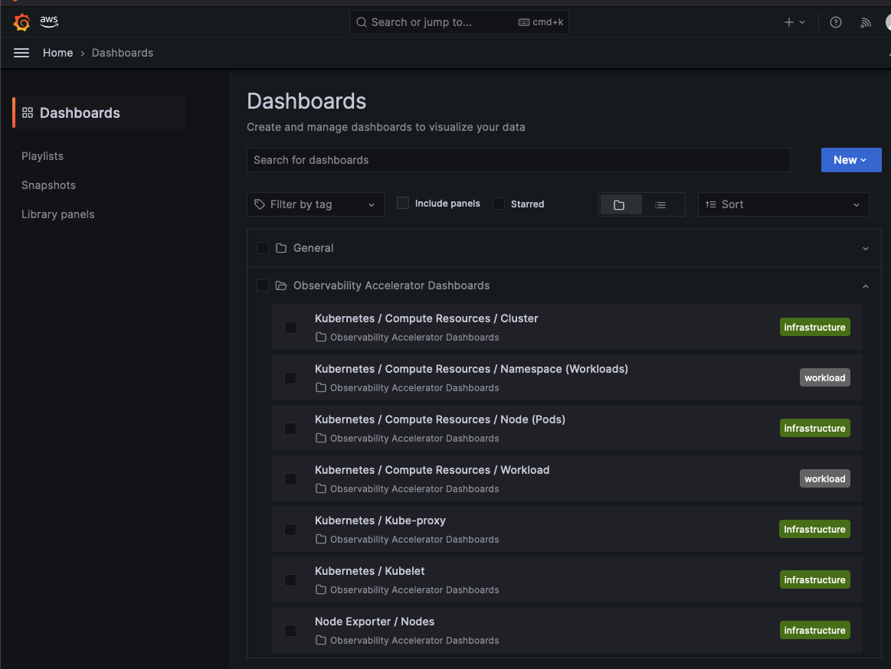
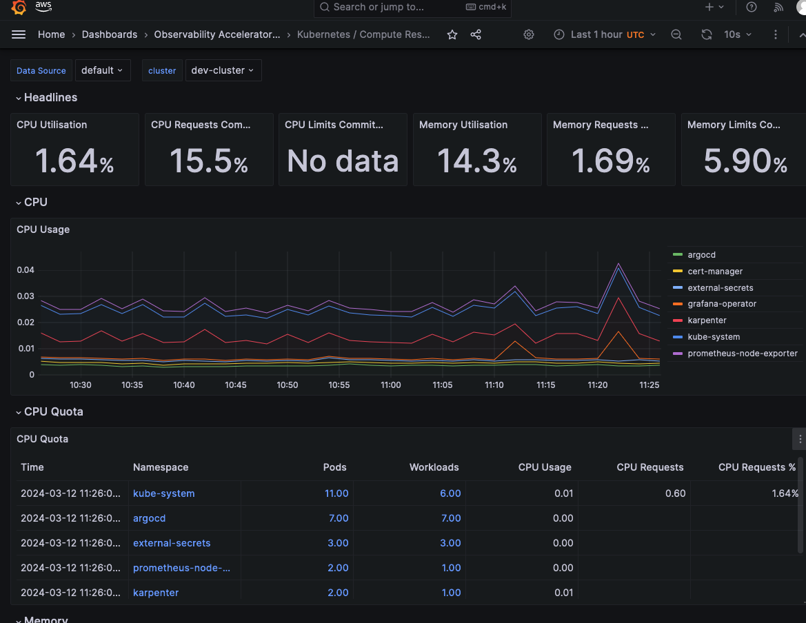
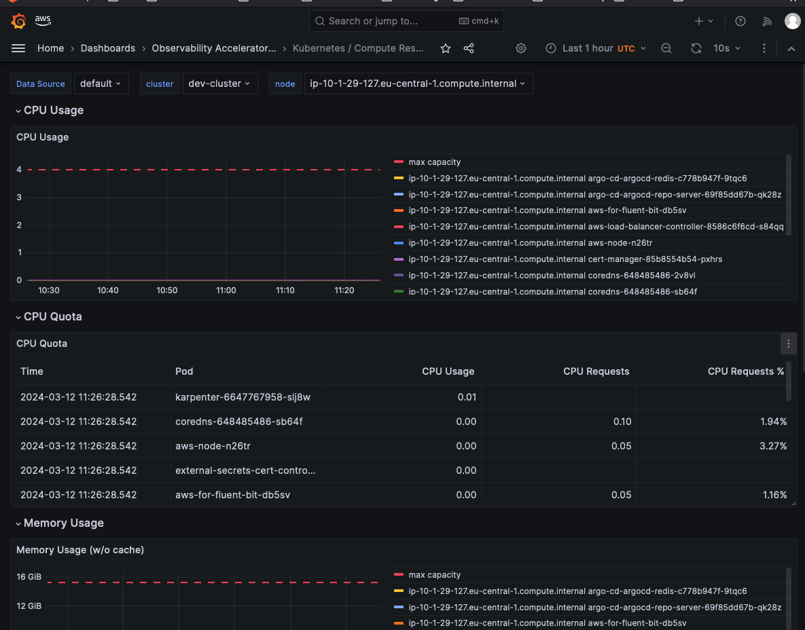

# 40.observability/45.aws-oss-observability

This optional stage adds cluster monitoring on AWS managed open-source services.
It creates resources only when `observability_configuration.aws_oss_tooling =
true` (the template sets it to `false`): an Amazon Managed Service for
Prometheus workspace with recording rules, a managed scraper that
collects the cluster's metrics into it, Prometheus node-exporter and
kube-state-metrics on the cluster, and an Amazon Managed Grafana workspace that
signs users in through IAM Identity Center. For Grafana it creates an Identity
Center user `grafana-admin-<env>` in a group `grafana-admins-<env>` with the
admin role, and installs the grafana-operator, which connects to the workspace
with an API key (stored in SSM Parameter Store and delivered to the cluster by
External Secrets), registers the Prometheus workspace as a data source and
loads a set of cluster dashboards. The API key is valid for 30 days; the first
apply of this stage after day 24 replaces it. With
`aws_oss_tooling_config.enable_adot_collector = true` it also installs the ADOT
EKS add-on.

It needs IAM Identity Center enabled in the account, and `30.eks/35.addons`
applied with the same `observability_configuration`, because that stage
installs External Secrets. Amazon Managed Grafana is not available in the AWS
European Sovereign Cloud.

## Deploy

`./platformctl up <env>` applies this stage last; with `aws_oss_tooling = false`
it creates nothing. This stage alone, from the repository root:

```bash
AWS_REGION=<region> make -C terraform plan  MODULE=40.observability/45.aws-oss-observability ENVIRONMENT=<env>
AWS_REGION=<region> make -C terraform apply MODULE=40.observability/45.aws-oss-observability ENVIRONMENT=<env>
```

`apply` does not ask for confirmation. `make` reads
`terraform/00.global/vars/<env>.tfvars` and stops if it is missing; unlike
`platformctl` it does not read `region` from that file, so pass `AWS_REGION`.

## Inputs

Set in `terraform/00.global/vars/<env>.tfvars`; the documented template is
[`example.tfvars`](../../00.global/vars/example.tfvars).

- `observability_configuration.aws_oss_tooling` - `true` to create the stack.
- `observability_configuration.aws_oss_tooling_config` - optional map:
  `enable_managed_collector` (default `true`), `enable_grafana_operator`
  (default `true`), `enable_adot_collector` (default `false`), `sso_region`
  (the IAM Identity Center region, when it is not the deploy region).
- `shared_config.resources_prefix` - with the environment name, the name of the
  two workspaces.
- `grafana_admin_email` - the address of the Grafana admin user is
  `<env>-<grafana_admin_email>`.
- `tags` - extra tags for every resource.

Not in the template: `go_config`, `ne_config` and `ksm_config` override the Helm
chart settings of the grafana-operator, node-exporter and kube-state-metrics.

## Outputs

None.

## Using it

The Grafana admin user has no password yet. Reset it in the IAM Identity Center
console, then sign in to the workspace:



The dashboards are already loaded:





To query the Prometheus workspace directly, use `awscurl` as described in the
[Amazon Managed Service for Prometheus documentation](https://docs.aws.amazon.com/prometheus/latest/userguide/AMP-compatible-APIs.html).
